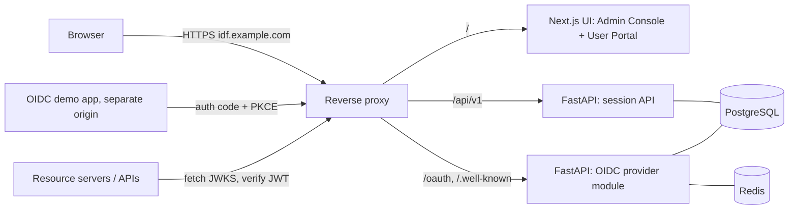

# ADR 005: OpenID Connect provider

- Status: **Accepted** (owner decisions of 2026-11-06 recorded below; implementation starts at milestone 0)
- Date: 2026-11-06
- Inputs: [IdP architecture research](../research/idp-architecture.md), ADR 002/003 (sessions, RBAC, MFA)

## Context
IdentityForge authenticates users (password, TOTP, passkeys) and keeps server-side sessions, but cannot yet act as an identity provider for other applications. This ADR designs an OIDC Provider (OP) so first-party and third-party apps can rely on IdentityForge for sign-in and API access.

## Accepted decisions (owner, 2026-11-06)

| # | Topic | Decision |
|---|---|---|
| D1 | Relying parties | Launch with **Admin Console**, **End-User Portal** (trusted first-party, no consent screen) and a separate **OIDC demo app** (third-party; exercises consent). |
| D2 | Hostname | One HTTPS hostname, path-based routing for UI, API and OIDC endpoints. Local dev: localhost behind a reverse proxy (same-origin routing). |
| D3 | Tokens | Short-lived **JWT access tokens (RS256)** for APIs needing independently verifiable tokens; **opaque rotating refresh tokens**; first-party browser auth stays **session-cookie based**. Opaque access tokens + introspection designed for, built later. |
| D4 | Client credentials | In the architecture now; **implemented in Phase 2**. Least-privilege scopes, audience restrictions, client authentication, credential rotation. |
| D5 | Tenancy | **Tenant-aware data model from day one; ships single-tenant.** Every tenant-owned resource and authorization query is tenant-scoped. No multi-tenant admin in the MVP. |
| D6 | Signing | **RS256** first; JWKS, `kid`, encrypted private-key storage, rotation; signer abstraction extensible to ES256. |

Mandatory constraints: follow RFC 9700; Authorization Code + PKCE for interactive clients; **no implicit flow, no resource-owner password grant**; exact redirect URI matching; appropriate client authentication; validate issuer, audience, signature, expiry and other applicable claims; first-party session authentication is distinct from OIDC relying-party authentication; skipping consent never bypasses authentication or authorization.

## Goals
Discovery, JWKS, UserInfo; ID tokens with honest `auth_time`/`amr`/`acr`; rotating refresh tokens with reuse detection; revocation; admin client management; consent management; OpenID conformance (Basic OP, Config OP) before any certification claim.

## Non-goals (this ADR)
Implicit and password grants (never), dynamic client registration, SAML, SCIM, multi-tenant administration, DPoP/mTLS, device flow. `private_key_jwt` client auth is a later addition (designed for, see §7).

## Design

### 1. Topology (D2)

Issuer: `https://<host>` (no path) so `/.well-known/openid-configuration` is at the root; OIDC endpoints under `/oauth/*`. The OP is a module inside the existing modular monolith (`backend/app/oidc/`), not a separate service. Because UI, API and OP share one origin, the first-party UI needs no CORS. The demo app is cross-origin; only `token`, `userinfo`, `jwks` and discovery get a separate CORS policy (no credentials).

### 2. First-party sessions vs OIDC relying parties (D1, D3)
Two distinct mechanisms, kept separate in code and in the audit trail:
- **IdentityForge session (IdP session):** opaque cookie, CSRF-protected, as today. The Admin Console and End-User Portal use it directly for their own UI; this does not change.
- **OIDC relying-party authentication:** a client obtains tokens by code + PKCE. The IdP session is what authenticates the user at `/oauth/authorize`.

Admin Console and User Portal are registered as **first-party clients** (flag `first_party=true`, admin-set only) so that *their* APIs and any future separate front-ends can obtain JWT access tokens with the same machinery. A first-party client still goes through authorize, PKCE, redirect matching and scope allow-listing; only the consent *screen* is skipped. Clarification to confirm in review: the two first-party UIs keep cookie sessions for browser auth; they are not required to run an OIDC login against themselves.

### 3. Login and consent (server-stored pending request)
`/oauth/authorize` validates client, exact redirect URI, scopes, PKCE S256 challenge, `response_type=code` only, then stores the request server-side and redirects to the UI with an opaque `request_id`. The UI uses the IdP session (log in/step up if needed), shows consent when required, and posts the decision (CSRF-protected). Codes are minted from the stored request, so parameters cannot be altered between login and consent.
- Consent required when: client is not first-party, or requested scopes exceed what the user previously granted (granted consents stored and revocable).
- First-party consent skip: records an implicit consent row (`granted_via=first_party`) for audit; **authentication still required, user must be active, scopes still limited to the client's allow-list, and the user's own authorization is still evaluated** (a scope or `groups`-based claim is never granted merely because consent was skipped).
- `prompt=none|login|consent`, `max_age`, `acr_values` evaluated against session `auth_time`/`amr`.

### 4. Session prerequisites (milestone 0/1)
Add `auth_time` and `amr` to the session, set in `complete_login`. Mapping: password→`pwd`; TOTP→`otp`; passkey→`hwk` + `user` where UV; combined login adds `mfa`. `acr`: `urn:identityforge:acr:1` (single factor), `:2` (MFA or passkey). A step-up re-authentication updates `auth_time`/`amr`.

### 5. Tokens (D3)
- **Authorization code:** random, ≤60 s, single use, hashed at rest, bound to client + redirect URI + PKCE challenge; replay revokes tokens already issued from it (RFC 6749 §4.1.2).
- **ID token:** JWT, `iss`, `sub` (stable opaque user id, not email), `aud` (client_id), `exp`, `iat`, `nonce`, `auth_time`, `amr`, `acr`, `at_hash`; profile/email/groups by scope. `azp` when needed.
- **Access token:** JWT per RFC 9068: header `typ: at+jwt`, claims `iss`, `sub`, `aud` (resource/API identifier), `client_id`, `scope`, `exp`, `iat`, `jti`, plus `tenant` (see D5). Lifetime 5–10 minutes (default 10, configurable per API). Resource servers must validate signature (allow-listed `alg` = RS256), `iss`, `aud`, `exp`, `typ`.
- **Refresh token:** opaque, hashed at rest, rotating, per-family; reuse of a rotated token revokes the family and is audited; absolute lifetime bounded; sender-constrain deferred. Public clients always rotate.
- **Opaque access tokens + introspection (RFC 7662/9701):** reserved. Token record schema carries `format` so an `opaque` mode can be added without a migration of meaning.

### 6. Signing keys (D6)
Signer abstraction: `Signer.sign(payload) -> JWS`, `KeySet.public_jwks()`, with RS256 (2048-bit minimum, 3072 preferred) now and an ES256 implementation addable without API change (`alg` is stored per key; verification allow-lists per client/RS). Private keys encrypted at rest with a dedicated `OIDC_KEY_ENCRYPTION_KEY` (Fernet, same approach as MFA, separate key); never logged; never returned by any API. `kid` = RFC 7638 thumbprint. Rotation: generate → publish in JWKS → start signing after a delay → keep retired public key until `max token TTL + clock skew + JWKS cache TTL`; emergency rotation via CLI. JWKS served with cache headers shorter than the overlap window.

### 7. Client authentication (D4)
- Interactive clients: **public** (PKCE only, `token_endpoint_auth_method=none`) or **confidential** (`client_secret_basic`; secret random 256-bit, stored as a keyed hash or Argon2id, shown once). PKCE is required for confidential clients too.
- Service clients (Phase 2): `client_credentials` grant, confidential only; each service client has an explicit **allowed scopes** list and **allowed audiences** list; request is rejected if a requested scope/audience is outside it. No refresh token, no ID token. Credentials: two secrets may be active at once for zero-downtime **rotation**, with expiry and last-used tracking. `private_key_jwt` is the planned upgrade (stored JWKS per client).
- Redirect URIs: exact string match; HTTPS required except loopback for native/dev; no wildcards, no fragments.

### 8. Tenancy (D5)
- `tenants` table with one seeded default tenant. `tenant_id` (NOT NULL, FK) on every tenant-owned table: users, groups, memberships, sessions, audit events, OIDC clients, consents, codes, refresh tokens, signing keys (keys may be per-tenant to support per-tenant issuers later).
- Enforcement: a `TenantContext` resolved once per request (single tenant now: the default; later by host/path) and passed explicitly into repositories/services; queries go through helpers that **always** add `tenant_id`; no unscoped query on a tenant-owned table outside migrations/CLI. Unique constraints become `(tenant_id, …)`, e.g. email unique per tenant.
- Tokens carry the tenant; resource servers must check it. Issuer stays a single URL in the MVP; per-tenant issuers (path or host) are a later change.
- Not shipped in the MVP: tenant creation APIs/UI, cross-tenant admin.

### 9. Endpoints
`GET /.well-known/openid-configuration`, `GET /oauth/jwks`, `GET|POST /oauth/authorize`, `POST /oauth/token`, `GET|POST /oauth/userinfo`, `POST /oauth/revoke`, `GET|POST /oauth/logout` (RP-initiated; `id_token_hint` + registered `post_logout_redirect_uri`, exact match). Later: `/oauth/introspect`.

### 10. Security controls
RFC 9700 baseline; `state` and `nonce` supported; PKCE S256 only (no `plain`); `response_type=code` only; token endpoint rate limited per client+IP (Redis); no credentialed CORS on OIDC endpoints; `frame-ancestors 'none'` + `X-Frame-Options: DENY` on login/consent pages; `Cache-Control: no-store` on token responses; `iss` response parameter (RFC 9207) returned on authorization responses; client management requires `require_admin` (so MFA policy applies); audit every client, consent, token-issuance, reuse and key event.

### 11. Data model (Alembic 0007+)
`tenants`; `tenant_id` added to existing tables (0007); `sessions.auth_time`, `sessions.amr` (0008); `oidc_clients`, `oidc_client_secrets`, `oidc_pending_requests`, `oidc_codes`, `oidc_consents`, `oidc_refresh_tokens` (family, parent, used_at, revoked_at), `oidc_signing_keys` (0009+). Audit actions (plain strings): `OIDC_CLIENT_CREATED/UPDATED/DELETED/SECRET_ROTATED`, `OIDC_CONSENT_GRANTED/REVOKED`, `OIDC_TOKEN_ISSUED`, `OIDC_REFRESH_REUSE_DETECTED`, `OIDC_KEY_ROTATED`.

### 12. Library choice
"Mature cryptographic libraries only": JWS/JWK via `joserfc` (or `authlib.jose`). Protocol logic (authorize/token validation) is the part most likely to hide bugs; spike Authlib's framework-agnostic server pieces against a hand-written implementation in milestone 1 before committing. Never hand-roll signature primitives.

## Standards review (flags before implementation)
1. **No genuine standards conflict** in the accepted decisions.
2. **Revocation trade-off (D3):** JWT access tokens cannot be revoked before `exp` without introspection or a deny-list. Mitigation: ≤10 min lifetime; deactivation/reset revokes refresh tokens and sessions immediately; APIs that need immediate revocation must use the later opaque/introspection mode. Accepted risk, to be documented in the API guide.
3. **"First-party UIs are RPs" vs cookie sessions (D1/D3):** not a conflict, but needs the clarification in §2 (they keep cookie sessions; OIDC clients exist for token-based API access).
4. **Consent skip (D1):** permitted by OIDC Core/OAuth; implemented as above so it never skips authN/authZ.
5. **Path-based single host (D2):** valid; issuer has no path component. The demo app being on another origin is expected.
6. **Audience (D4):** RFC 6749 has no audience parameter; use RFC 8707 `resource` (preferred) with per-client allowed audiences. Tokens for multiple audiences are not issued.
7. **RS256 (D6):** fine; RFC 9700 does not forbid it. 2048-bit minimum. Algorithm allow-list on every verifier (never trust the token header `alg`).

## Implementation backlog
| ID | Milestone | Work | Status |
|---|---|---|---|
| M0.1 | Tenancy foundation | `tenants` + `tenant_id` migration (0007) on all tenant-owned tables, default tenant, fail-closed ORM scoping (`backend/app/tenancy.py`), per-tenant unique email/username | **Done** (branch `feature-tenancy-foundation`) |
| M0.2 | Tenancy tests | Cross-tenant isolation tests (`tests/test_tenancy.py`): fail-closed, scoped reads/writes/bulk delete, admin API, login, audit | **Done** |
| M1.1 | Session facts | `sessions.auth_time` + `amr` (migration 0008), set in `complete_login` via `auth/authn.py`; `/login` and `/me` expose `auth_time`/`amr`/`acr`; tests per method. Step-up re-auth that updates them is M4 | **Done** (branch `feature-session-auth-facts`) |
| M1.2 | Signing keys | RS256 keys (Fernet-encrypted with `OIDC_KEY_ENCRYPTION_KEY`), `/oauth/jwks`, rotation with publish-before-sign and retire-after-overlap, emergency revocation, super-admin API + `rotate-signing-key` CLI, JWT sign/verify with alg allow-list; ES256 slot reserved | **Done** (branch `feature-oidc-signing-keys`) |
| M1.3 | Client registry | `oidc_clients` / `oidc_client_secrets` (migration 0011), admin API + Applications page, exact redirect validation (https; http only for localhost; no wildcard/fragment), Argon2id secret hashing with two-secret rotation, `authenticate_client`, first-party flag (super admin only) | **Done** (branch `feature-oidc-clients`) |
| M1.4 | Discovery | `/.well-known/openid-configuration`, issuer/config settings | **Done** (with M2.2) |
| M2.1 | Authorize + consent | Pending requests, PKCE S256, consent UI, first-party skip rules | Done (prompt=login, select_account and max_age are rejected with request_not_supported until M4; acr_values is ignored, which the spec allows) |
| M2.2 | Token endpoint | Code exchange, ID token, RFC 9068 JWT access tokens, UserInfo | **Done.** `sub` is `users.public_id` (UUID, migration 0014). Access token `aud` is the issuer until a resource registry exists. No refresh token yet (M3), so `offline_access` is not echoed in `scope`. No CORS on token/userinfo yet (browser-only public clients on other origins unsupported). A replayed code is audited; revoking tokens already issued from it arrives with refresh families in M3 (access tokens are short-lived JWTs) |
| M3 | Refresh + revocation | Rotation, family reuse detection, `/oauth/revoke` | **Done.** `oidc_refresh_tokens` (migration 0015): hashed, rotating, family id, 7-day idle / 30-day absolute limits (`OIDC_REFRESH_IDLE_DAYS`, `OIDC_REFRESH_ABSOLUTE_DAYS`). Reuse of a rotated token revokes the family (audited); a replayed code revokes the families it issued; withdrawing consent (`/me/consents`, Connected applications card) revokes them. Strict reuse detection, no grace window: a client that retries a refresh after a lost response is signed out. Access tokens (JWT) cannot be recalled; `/oauth/revoke` says so (`unsupported_token_type`). Expired rows are not purged yet |
| M4 | Logout + prompts | RP-initiated logout, `max_age`/`prompt`/`acr_values` | |
| M5 | Demo app + e2e | Separate OIDC demo (third-party consent), Playwright flows | |
| M6 | Hardening | Conformance suite (Basic/Config OP), security review, rate limits, docs | |
| P2.1 | Client credentials | Service clients, scope/audience allow-lists, secret rotation, tests | Phase 2 |
| P2.2 | Opaque tokens + introspection | RFC 7662 | Later |
| P2.3 | `private_key_jwt`, ES256 signer | | Later |

## Automated test requirements
- **Token validation:** wrong `iss`, wrong `aud`, bad signature, `alg` confusion (`none`/HS256), expired, wrong `typ`, `nonce` mismatch, tampered claims.
- **Client authorization:** unknown client, wrong secret, redirect mismatch (prefix/case/trailing slash/wildcard), missing/`plain` PKCE, scope outside allow-list, code replay, code from another client, refresh reuse, first-party skip never bypasses authN or inactive user.
- **Cross-tenant isolation:** user/group/session/client/token/consent access across tenants returns not-found/denied; tokens for tenant A rejected for tenant B resources.
- **Key rotation:** old tokens verify during overlap, fail after retirement; new tokens use the new `kid`; JWKS contains both during overlap; private keys never in API output or logs.
- Playwright: first-party flow (no consent), demo app flow (consent, deny, revoke).

## Risks
Subtle protocol bugs (conformance suite, spike, review); tenancy retrofit touches every existing query (M0 first, with isolation tests); session-model change touches every login path; key-management mistakes; JWT revocation latency (§Standards 2); scope creep toward a full IdP.
