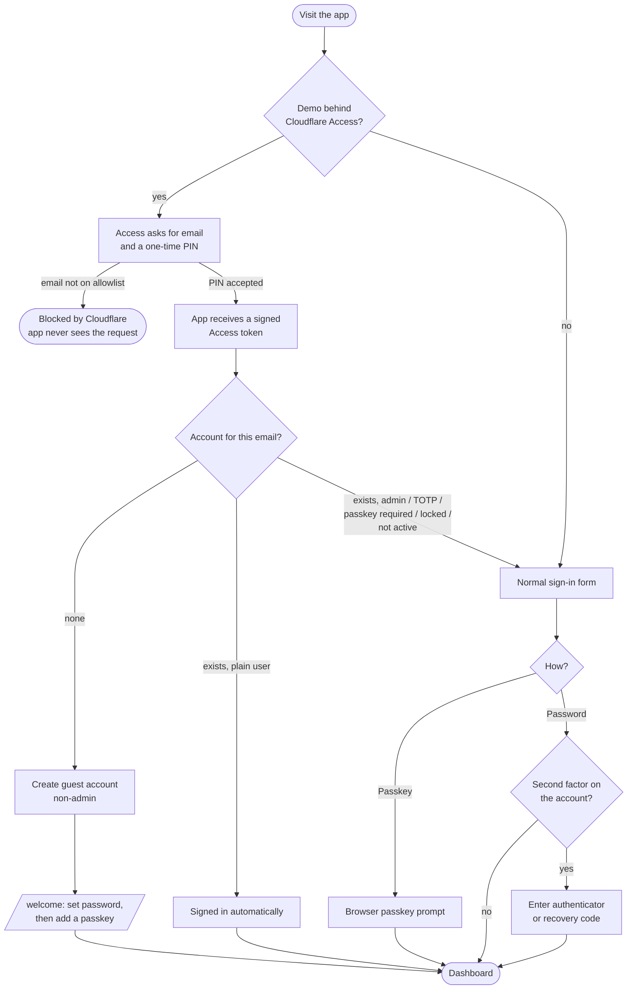
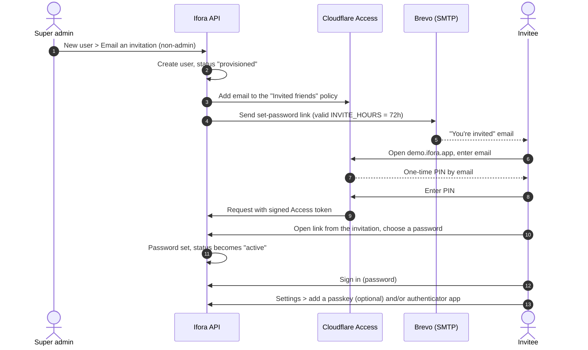
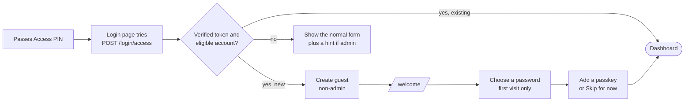
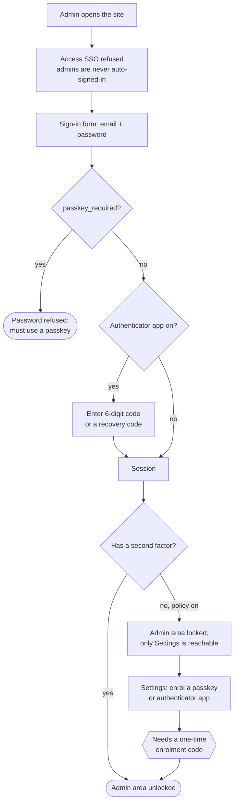
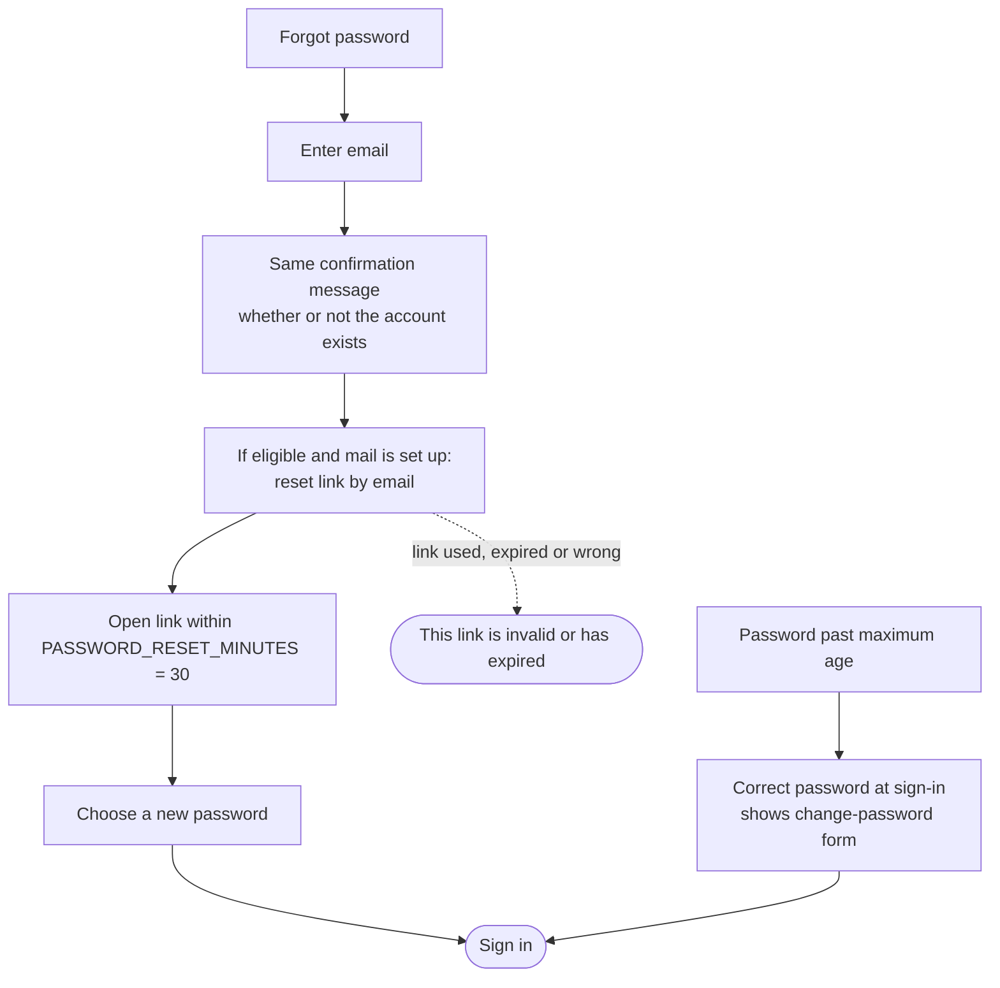

# Sign-in flow and user experience

How people get into Ifora, what they see at each step, and what happens when something goes wrong. It covers the invite-only demo (https://demo.ifora.app, where Cloudflare Access sits in front of the app) and the regular stack (dev/prod, no Access).

Everything here describes behaviour that exists in `main`. Where a number comes from configuration, the setting name is given.

## Who is who

| Kind of account | How it is created | How it signs in |
|---|---|---|
| **Guest** (demo, non-admin) | Allowlisted in Cloudflare Access, or invited by an admin | Access one-time PIN, then automatic sign-in; password and passkey afterwards |
| **Invited user** | Admin uses *New user > Email an invitation* | Link in the email sets a password, then normal sign-in |
| **Admin** | Created or promoted by a super admin | Password, then a second factor (passkey or authenticator app). Never signed in by Access alone |
| **Super admin** | Operator promotes (CLI) | Same as admin; their first enrolment code comes from the operator CLI |

## 1. Big picture

## 2. Invited by an admin (the "email an invitation" path)

This is what happened for the end-to-end test (audit: `USER_CREATED`, `USER_INVITED`, `PASSWORD_RESET_COMPLETED`, `LOGIN_SUCCESS`, `PASSKEY_REGISTERED`, `MFA_ENABLED`).

What the invitee sees: the email, the Cloudflare PIN screen, a "set your password" page that enforces the password policy, then the dashboard. If the admin did not allow email, the dialog shows a temporary password instead (shown once, before any notices).

The admin sees, after submitting: *created*, whether the **Access allowlist** step succeeded, and whether the **email** was accepted. A failure in either is shown as a notice; it never blocks creating the account.

## 3. Guest who is only on the allowlist (no invitation)

- The token is a Cloudflare-signed JWT; the API checks signature, issuer, audience and expiry against Cloudflare's public keys and fails closed if it cannot.
- The session is recorded as a one-time-PIN sign-in (`amr = otp`). It is deliberately weaker than password+MFA, which is why admins are excluded.
- `/welcome` accepts the one-shot "set initial password" call only for that exact kind of session and only while no password has ever been set.

## 4. Returning visitors

| Situation | What happens |
|---|---|
| Open the site with a live Access cookie and a plain account | Signed in automatically, straight to the dashboard |
| Just clicked **Sign out** | The automatic sign-in is paused for that tab, and the page offers a "Continue with your invitation" button, so signing out is not instantly undone |
| Access cookie expired | Cloudflare asks for a new PIN first |
| Prefer a passkey | Sign in with the passkey from the form; no password needed |

## 5. Administrators

### Getting the enrolment code

An admin with no second factor cannot enrol one using the password alone; they need a one-time code, which proves someone (or their mailbox) vouches for them.

| Who | Where the code comes from |
|---|---|
| Admin (not super) with `ENROLLMENT_CODE_EMAIL=true` | **Email me a code** next to the field in Settings. Sent to their own address only, never shown in the response |
| Admin with the setting off | A super admin issues it from the user's page, or the operator runs `python -m backend.cli issue-enrollment-code <email>` |
| Super admin | Operator CLI only (nobody above them) |

Code rules: 12 characters, shown as `XXXX-XXXX-XXXX`, single use, valid 24 hours, only a hash is stored, a new request replaces the old code. The email route allows 3 requests per 10 minutes per user and is audited as `ENROLLMENT_CODE_ISSUED` with `via: email`. Password re-entry is still required to enrol.

Enabled on: demo and dev/prod (since 2026-11-12).

## 6. Forgot or expired passwords

- Account enumeration resistance: the forgot-password reply and failed sign-in errors are identical for unknown, wrong-password, locked and inactive accounts.
- Invitation links are the same mechanism with a longer life (`INVITE_HOURS` = 72). An admin can resend one for accounts still staged or provisioned.
- Only someone who already typed the correct password is told that it has expired.

## 7. When sign-in is refused

| Cause | What the person sees | Why |
|---|---|---|
| Email not on the Access allowlist | Cloudflare's own page; the app is never reached | Allowlist is the gate for the demo |
| Wrong email or password, locked, suspended, deprovisioned, staged | One generic "invalid" message | Does not reveal which |
| Too many failures | Locked for `LOGIN_LOCKOUT_MINUTES` = 15; also an IP rate limit (`RATE_LIMIT_LOGIN_FAILURES` = 10 per 300s) | Stops guessing. A known address of the real user can still get in during a lockout, so a stranger cannot lock someone out |
| Account requires a passkey | "This account requires signing in with a passkey" | Phishing-resistant policy; password never starts a session |
| Admin tries the Access shortcut | Normal form with a note to use the password | Admins always use password plus a second factor |
| Link invalid, used or expired | "This link is invalid or has expired" | Single-use, time-limited tokens |

## 8. Sessions and sign-out

- Session cookie is opaque, HttpOnly, SameSite, and Secure behind HTTPS.
- Lifetime `SESSION_LIFETIME_HOURS` = 8; idle timeout `SESSION_IDLE_TIMEOUT_MINUTES` = 30.
- Sign out ends the server session. In the demo it also pauses the automatic Access sign-in for that browser tab (see section 4).
- Deleting a user removes them from the Access allowlist (admins see the result of that step).

## 9. Use cases at a glance

| # | Scenario | Path |
|---|---|---|
| 1 | Friend invited by an admin | Invite email, PIN, set password, sign in, optional passkey |
| 2 | Friend only added to the allowlist | PIN, auto account, `/welcome` (password, passkey or skip) |
| 3 | Friend comes back later | PIN if cookie expired, then automatic sign-in |
| 4 | Friend signs out and returns | Asked before being signed back in |
| 5 | Friend forgets password | Forgot-password email, 30 minute link |
| 6 | Friend not on the list | Stopped at Cloudflare |
| 7 | Invitation link expired | Admin resends the invitation |
| 8 | Admin signs in | Password, then authenticator code or passkey |
| 9 | Newly promoted admin | Locked to Settings until a factor is enrolled; code by email |
| 10 | Super admin first factor | Operator-issued enrolment code |
| 11 | Account needs passkey only | Passkey sign-in; password is refused |
| 12 | Lost authenticator app | Recovery code, or an admin resets their factors |
| 13 | Account removed | Deleted, allowlist entry removed, cannot reach the app |
| 14 | Regular stack (no Access) | Skip the Cloudflare steps: sign-in form, MFA, passkeys, recovery, as above |

## 10. Operator notes

- Demo switches: `ACCESS_SSO_ENABLED`, `ACCESS_TEAM_DOMAIN`, `ACCESS_AUD`, `ACCESS_ALLOWLIST_*` (policy sync), `ENROLLMENT_CODE_EMAIL`, `SMTP_*` in `~/ifora-demo/.env.demo`.
- Regular stack: `ENROLLMENT_CODE_EMAIL` and `SMTP_*` in `docker/.env`.
- Code: `backend/app/auth/` (`routes.py`, `access_sso.py`, `access_allowlist.py`, `mfa_routes.py`, `passkey_routes.py`, `recovery_routes.py`), `backend/app/users/routes.py` (invites), pages under `frontend/src/app/` (`login`, `welcome`, `accept-invite`, `forgot-password`, `reset-password`, `settings`).
- Tests: `backend/tests/test_access_sso.py`, `test_access_allowlist.py`, `test_enrollment_code_email.py`, `test_admin_mfa_policy.py`, and browser specs `frontend/e2e/access-sso.spec.ts`, `enrolment-code-email.spec.ts`.

## 11. Known limits

- Real-browser coverage of the Access PIN screen is manual; automated tests stub the Access token at the API boundary.
- Delivery of emails depends on Brevo; the app can only confirm that the mail server accepted a message.
- The demo runs only while the host machine and Docker are up.
